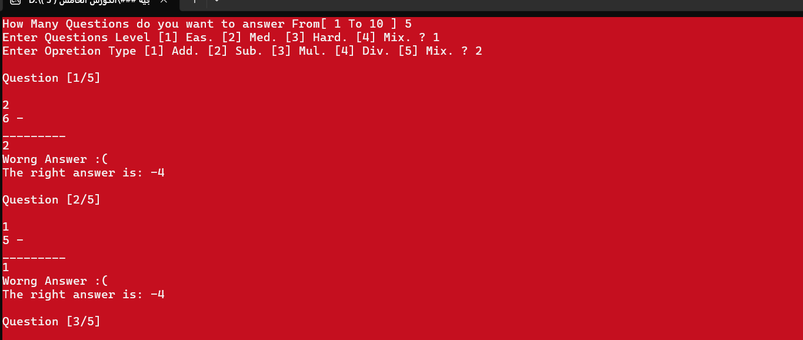
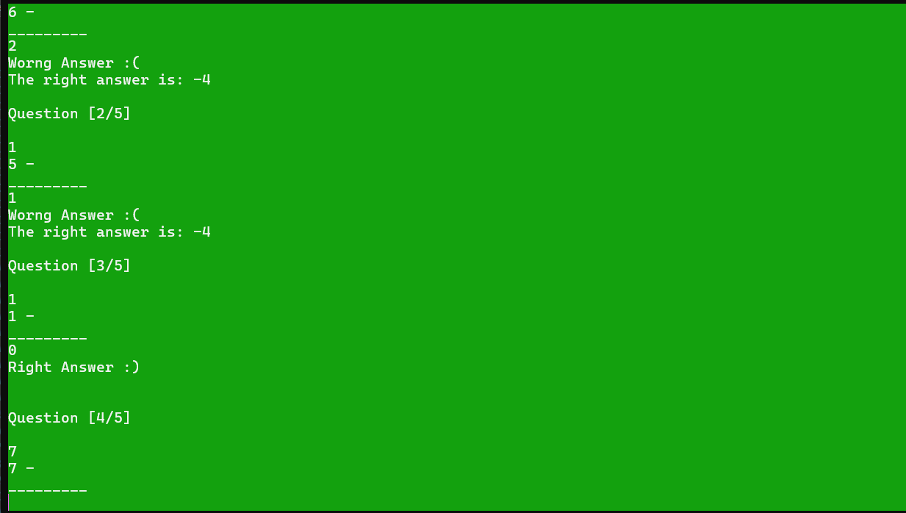

# Math Quiz Game (C++)

A customizable, console-based Math Quiz Game developed in C++ to test and improve mental arithmetic skills through interactive, multi-level challenges.

## 🚀 Key Features
* Custom Quiz Configuration: Choose the exact number of questions per session.
* 4 Difficulty Levels: Supports Easy, Medium, Hard, and Mix modes.
* 4 Arithmetic Operations: Supports Addition (+), Subtraction (-), Multiplication (*), Division (/), and Mix.
* Instant Feedback: Real-time answer validation with visual color cues (Green for correct answers, Red for incorrect answers).
* Final Performance Summary: Displays total questions, right/wrong answers count, selected difficulty, operation type, and final Pass/Fail status.

## 🛠️ Technical Highlights & Architecture
* Built using Functional Programming principles with modular, single-responsibility functions.
* Utilized **enums and structs** for clean state management and structured quiz data.
* Implemented pseudo-random number generation (rand()) to ensure unique questions in every round.

## 💻 How to Run
1. Clone the repository or download the .cpp source file.
2. Open the file in any C++ compiler/IDE (e.g., Visual Studio, Code::Blocks, or GCC).
3. Compile and run the program to start the quiz.

## 📸 Screenshots
### Quiz Setup & Questions

### Gameplay Screen

### Final Results Summary

